# WyrmUrbiGen

<div align="center">

**Italiano** · [English](README.md)

</div>

<table align="center"><tr><td><pre>
                                 ____
                              .-"    `-.      ,
                            .'          '.   /j\
                           /              \,/:/#\                /\
                          ;              ,//' '/#\              //#\
                          |             /' :   '/#\            /  /#\
                          :         ,  /' /'    '/#\__..--""""/    /#\__
                           \       /'\'-._:__    '/#\        ;      /#, """---
                            `-.   / ;#\']" ; """--./#J       ':____...!
                               `-/   /#\  J  [;[;[;Y]         |      ;
""""""---....             __.--"/    '/#\ ;   " "  |     !    |   #! |
             ""--.. _.--""     /      ,/#\'-..____.;_,   |    |   '  |
                   "-.        :_....___,/#} "####" | '_.-",   | #['  |
                      '-._      |[;[;[;[;|         |.;'  /;\  |      |
                      ,   `-.   |        :     _   .;'    /;\ |   #" |
                      !      `._:      _  ;   ##' .;'      /;\|  _,  |
                     .#\"""---..._    ';, |      .;{___     /;\  ]#' |__....--
          .--.      ;'/#\         \    ]! |       "| , """--./_J    /
         /  '%;    /  '/#\         \   !' :        |!# #! #! #|    :`.__
        i__..'%] _:_   ;##J         \      :"#...._!   '  "  "|__  |    `--.._
         | .--""" !|""""  |"""----...J     | '##"" `-._       |  """---.._
     ____: |      #|      |         #|     |          "]      ;   ___...-"T,
    /   :  :      !|      |   _______!_    |           |__..--;"""     ,;MM;
   :____| :    .-.#|      |  /\      /#\   |          /'               ''MM;
    |""": |   /   \|   .----+  ;      /#\  :___..--"";                  ,'MM;
   _Y--:  |  ;     ;.-'      ;  \______/#: /         ;                  ''MM;
  /    |  | ;_______;     ____!  |"##"""MM!         ;                    ,'MM;
 !_____|  |  |"#"#"|____.'""##"  |       :         ;                     ''MM
  | """"--!._|     |##""         !       !         :____.....-------"""""" |'
  |          :     |______                        ___!_ "#""#""#"""#"""#"""|
__|          ;     |MM"MM"""""---..._______...--""MM"MM]                   |
  "\-.      :      |#                                  :                   |
    /#'.    |      /##,                                !                   |
   .',/'\   |       #:#,                                ;       .==.       |
  /"\'#"\',.|       ##;#,                               !     ,'||||',     |
        /;/`:       ######,          ____             _ :     M||||||M     |
       ###          /;"\.__"-._   """                   |===..M!!!!!!M_____|
                           `--..`--.._____             _!_
                                          `--...____,="_.'`-.____        fsc
</pre></td></tr></table>

<div align="center">

<br>
Compatibile con qualunque gioco di ruolo analogico "OSR". Fratello di [WyrmHex](https://github.com/alepersichetti/WyrmHex) e [WyrmDelve](https://github.com/alepersichetti/WyrmDelve).

</div>

### WyrmUrbiGen v1.0.0

**WyrmUrbiGen** disegna a caso **villaggi, paesi, città, grandi città, castelli e fortezze** per campagne old school (OSR), fatti solo di lettere e simboli come nei roguelike NetHack, ADOM e Dwarf Fortress. Ogni edificio ha il suo **numero** sulla mappa dell'arbitro, e la **chiave** (in `.txt` e in un **file formattato PDF**) racconta tutto dell'insediamento: storia, governo e fazioni, gli abitanti di ogni edificio con le loro statistiche OSR, la demografia, l'economia del contado, le voci e gli eventi.

All'avvio il programma chiede se l'insediamento è:

- un **luogo di riposo** per gli avventurieri: locande, guaritori, fabbri, cavalli, mercenari e seguaci da assoldare, prezzi in monete d'oro, lavori e agganci;
- un **luogo d'avventura**, **in rovina** oppure **abitato e minacciato**. In rovina (la scelta normale per una città): abbandonato da decenni o secoli, con brecce nelle mura e rovi nelle strade, popolato da mostri (la città dei morti, la tana dei goblin, il nido di una bestia, il drago addormentato, i fedeli del dio senza nome, la città sommersa, il giardino di funghi, la corte dei fantasmi, la roccaforte degli orchi), con **una storia a strati** (fondazione, splendore, caduta, e chi è venuto dopo, lasciando tracce negli edifici), chi comanda tra le rovine, voci, eventi e agganci per chi ci va. Abitato: una minaccia (briganti, un culto, la peste, una maledizione, un assedio di orchi, una bestia notturna, un signore negromante, qualcosa che sale dall'acqua, un drago, una miniera crollata, una faida). In tutti e due i casi, con un orologio di quello che succede se nessuno interviene, **mostri erranti, mostri e indizi negli edifici e tesori** presi dalle tabelle di WyrmDelve (bestiario e tesori di *Old-School Essentials*).

#### Tipi e popolazione

Scegli il tipo, oppure lascia che lo scelga il programma. La popolazione segue *Medieval Demographics Made Easy* di S. John Ross:

| Tipo | Abitanti |
|---|---|
| Villaggio | 20-1.000, di solito 50-300 |
| Paese (borgo) | 1.000-8.000, di solito 2.500 |
| Città | 8.000-12.000 |
| Grande città | 12.000-100.000 |
| Castello | 20-250 tra famiglia, servi e guarnigione |
| Fortezza | 80-1.000 tra guarnigione e civili |

Dopo il tipo puoi scrivere il numero esatto di abitanti (con Invio ne tieni uno casuale). Da quel numero vengono la densità (abitanti per ettaro), le abitazioni, i nobili, il clero, le guardie, il bestiame e quante botteghe di ogni mestiere ci sono (i *support value* dell'articolo: un calzolaio ogni 150 abitanti, una locanda ogni 2.000...). Le botteghe più importanti finiscono sulla mappa; tutte compaiono nella demografia. Nei luoghi grandi ogni riquadro numerato è un gruppo di case o un isolato.

#### Epoche: architettura e urbanistica

| Epoca | Come sono fatti |
|---|---|
| **Alto medioevo** | palizzate e fossati, villaggi sparsi attorno alla sala di legno del signore, castelli *motte and bailey* (terrapieno con torre di legno e recinto), *castra* romani rettangolari con cardo e decumano, città chiuse nel vecchio quadrato romano con le strade storte sopra la griglia antica |
| **Basso medioevo** | mura di pietra con torri, porte con le torri ai lati, piazze comunali con il palazzo del comune, cattedrali e battisteri, torri gentilizie, borghi franchi a griglia, conventi dei frati lungo le mura, castelli con il mastio e a volte un secondo recinto interno |
| **Rinascimento** | fortificazioni alla moderna con bastioni a punta di freccia, città ideali a raggiera o a griglia, fortezze stellate con la piazza d'armi, rocche quadrate con i bastioni agli angoli, palazzi, logge, polveriere, stamperie |

#### Terreni

Pianura, collina, montagna, foresta, palude, costa, fiume e lago. Il terreno cambia la mappa: il mare e il lago tagliano le mura e portano un molo, il fiume fa da fossato e si attraversa con un ponte, in montagna l'abitato si allunga sul crinale, la foresta lascia una radura di campi, la palude circonda un'isola asciutta. Attorno ci sono i **campi** a strisce e appezzamenti (arati, seminati, prati, frutteti), diversi per ogni terreno.

#### Economia del contado

Dalle regole di *OSR: Land and Investments* (Skerples, blog *Coins and Scrolls*): quanto è sviluppato il contado, quanti contadini e villaggi ci sono nell'esagono di 6 miglia attorno (lo stesso di WyrmHex), la rendita netta del signore (dimezzata o divisa per 10 nei tempi difficili, cioè quando c'è una minaccia), e **proprietà in vendita** con costo, rendita e affittuari: fattorie, manieri, locande, botteghe, miniere.

---

## 1. Cosa ti serve

Metti questi file nella **stessa cartella**:

- `wyrmurbigen.py` (il programma)
- la cartella `data` (le parole e le tabelle: edifici, abitanti, insediamenti, demografia, economia; mostri, indizi e tesori vengono da WyrmDelve)
- la cartella `fonts` (i font della mappa e del libro)
- `requirements.txt`

Ti serve **Python 3.8 o più recente** (meglio l'ultima versione).

## 2. Installazione

Come per WyrmHex e WyrmDelve, una volta sola:

**Windows**
```
py -m venv .venv
.venv\Scripts\activate
pip install -r requirements.txt
```

**macOS e Linux**
```
python3 -m venv .venv
source .venv/bin/activate
pip install -r requirements.txt
```

Le librerie sono **Pillow** (le immagini), **fpdf2** (il libro PDF) e **asciimatics** (i menu da scorrere con le frecce).

## 3. Creare un insediamento

Con l'ambiente virtuale attivo:

```
python wyrmurbigen.py
```

Compare la schermata di benvenuto con il castello, poi le domande. **Le domande a scelta sono menu**: frecce **↑ ↓**, **Invio** per confermare, oppure il numero dell'opzione. Le domande in cui scrivi hanno una risposta pronta tra parentesi quadre: Invio la accetta.

1. **Lingua**: italiano o inglese.
2. **Cosa vuoi fare?** Un insediamento casuale, **scelgo io**, oppure **rifaccio un insediamento dal suo seme**.
3. Se scegli tu, ogni domanda ha anche la risposta **A caso**:
   - **luogo di riposo o luogo d'avventura**;
   - **tipo** (villaggio, paese, città, grande città, castello, fortezza) e **numero di abitanti**;
   - **epoca** (alto medioevo, basso medioevo, Rinascimento);
   - **terreno** (pianura, collina, montagna, foresta, palude, costa, fiume, lago);
   - per un luogo d'avventura, il **pericolo** da 1 a 4 (per personaggi di livello 1-2, 3-4, 5-7, 8 e oltre) e lo **stato**: **in rovina** (mostri e storia a strati) o **abitato e minacciato**; a caso, una città è sempre in rovina, gli altri insediamenti una volta su tre;
   - la **lingua a cui somigliano i nomi dei luoghi**, ognuna con tre nomi di esempio: italiano medievale, inglese antico (Old English), inglese rinascimentale, gaelico scozzese, tolkieniano (elfico), persiano e arabeggiante, greco bizantino, tedesco, francese, danese e svedese, russo e baltico, oppure **una mescolanza di tutte**;
   - il **tono dei nomi**: luminoso, rustico, solenne, cupo o arcano (vedi [I nomi dei luoghi](#i-nomi-dei-luoghi));
   - **i nomi delle persone**: come i luoghi (la stessa lingua), **fantasy** (desinenze mescolate da tutte le lingue) oppure una lingua a scelta.
4. **Colori**: nero su bianco (per stampare), bianco su celeste, bianco su nero, oppure **a colori**, come in WyrmHex, su bianco o su nero: ogni simbolo nel suo colore (acqua blu, boschi verdi, mura grigio pietra, legno marrone, porte rosse, segreti magenta) e, su bianco, fondi chiari sotto acqua, strade ed edifici (vedi [A colori](#a-colori) nella galleria).
5. **Simboli**: quelli di WyrmDelve (`▓ █ ≈ ♣ ╔═╗`) oppure **solo i caratteri della tastiera**, come in WyrmHex.
6. **Nome sulla mappa**: quello generato, uno tuo, oppure nessuno.
7. **Cosa vuoi nella chiave**: storia, abitanti e (in un luogo d'avventura) mostri e tesori; Spazio segna e toglie.
8. **Unità**: metri o piedi.
9. **Formato di stampa**: A4, A3, A2 o A1, con quello consigliato già evidenziato.
10. **Che file vuoi**: mappe in **PNG** e libro PDF separati, mappe in **PDF** e libro PDF separati, oppure **un unico PDF** con le due mappe e poi il libro.
11. **Di nuovo, con un altro aspetto?** Alla fine puoi rifare lo stesso insediamento con altri colori, simboli, formato e file, quante volte vuoi: le mappe nuove non cancellano quelle di prima e hanno nel nome il formato e lo stile (`<seme>_referee_A3_c5.png`, `_c4_ascii`).

## 4. Il seme

Ogni insediamento ha un **seme**, come `C9500-B-R-A2R-DE4-K7Q2MB`: tipo e abitanti, epoca, terreno, scopo, pericolo e stato, nomi e tono, codice.

| Parte | Valori |
|---|---|
| Tipo | `V` villaggio, `B` paese, `C` città, `G` grande città, `K` castello, `F` fortezza, seguito dagli abitanti |
| Epoca | `A` alto medioevo, `B` basso medioevo, `R` Rinascimento |
| Terreno | `P` pianura, `H` collina, `M` montagna, `F` foresta, `S` palude, `C` costa, `R` fiume, `L` lago |
| Scopo | `R0` luogo di riposo, `A1`-`A4` luogo d'avventura con il suo pericolo, seguito dallo stato: `R` in rovina, `T` abitato e minacciato |
| Nomi | `IT` italiano medievale, `OE` inglese antico, `RE` inglese rinascimentale, `GA` gaelico scozzese, `TO` tolkieniano, `PA` persiano e arabeggiante, `BY` greco bizantino, `DE` tedesco, `FR` francese, `NO` danese e svedese, `RU` russo e baltico, `MX` mescolanza di tutte; poi il tono: `1` luminoso, `2` rustico, `3` solenne, `4` cupo, `5` arcano; poi, se le persone non hanno i nomi dei luoghi, `X` (fantasy) o il codice della loro lingua (`DE4NO`: luoghi tedeschi, persone danesi e svedesi) |

**Lo stesso seme dà sempre lo stesso insediamento**: mappa, abitanti, mostri e tesori. Il seme è anche il nome della cartella dentro `settlements_generated`. I semi delle versioni precedenti funzionano ancora e danno la stessa mappa: senza lo stato (come `C9500-B-R-A2-DE4-K7Q2MB`) la minaccia può essere una qualsiasi, rovine comprese; senza la parte dei nomi (come `C9500-B-R-A2-K7Q2MB`) i luoghi hanno i nomi italiani medievali di prima. Le persone, le famiglie, le città vicine e gli dei hanno però nomi inventati, come in tutti i semi nuovi.

### I nomi dei luoghi

WyrmUrbiGen è un generatore fantasy: non nomina luoghi, famiglie, santi o religioni del mondo reale. Parte da particelle reali di undici lingue per inventare nomi che *suonano* in quelle lingue, ma non esistono.

I nomi dell'insediamento, del dungeon vicino e delle botteghe che portano il nome di un luogo sono fatti con le **radici** di `data/names.json`: per ogni lingua, sillabe ed elementi per l'inizio, il mezzo e la fine di una parola, più parole intere che vanno prima (*Belle-*, *Borgo*, *Dar al-*) e dopo (*-le-Grand*, *Magna*, *am Berg*). Ogni tono ha radici sue, mescolate a quelle comuni. Ogni lingua con ogni tono dà **da 11 a 14 milioni di nomi**; la mescolanza di tutte, centinaia di miliardi.

Anche **i nomi delle persone** seguono la stessa lingua: nomi, cognomi e il modo di comporli (*Inga Bjørnsdotter*, *Cailean mac Artair*, *Bahram ibn Ismail*, *Berthold von Salzburg*, *Anna Olegovna*), e così le famiglie nei nomi degli edifici e delle fazioni; le città da cui vengono le persone sono città della stessa terra. Ogni nome è un inizio e una desinenza della lingua (*Wern* + *hart*, *Wulf* + *stan*, *Lebed* + *ensky*): particelle vere, nomi inventati, circa **1.050 nomi maschili, 1.050 femminili e 1.050 cognomi per lingua**. Ogni insediamento ha una dozzina di famiglie e una dozzina di città vicine, che tornano negli edifici, nelle fazioni, nella storia e nelle voci. Con `--persone` / `--people` puoi dare alle persone i nomi di **un'altra lingua** rispetto ai luoghi, oppure nomi **fantasy**: un inizio della lingua con una desinenza di una lingua qualsiasi (*Siegisa Zimmavi*, *Dietost Ludrawsohn*), circa 11.500 nomi per tipo. Anche queste radici stanno in `data/names.json`.

**Gli dei** sono inventati anche loro: ogni insediamento ne venera cinque, ognuno dio o dea di qualcosa (il raccolto, le tempeste, i morti, il mare sulla costa, la caccia nella foresta...), con nomi fatti da radici apposite (*Orsaldra*, *Velmor*, *Ilyra*). Templi, santuari, chiostri, monasteri, porte e quartieri portano i loro nomi; le chiese diventano templi, i vescovi gran sacerdoti, e sulla mappa le tombe sono `Ω` invece della croce.

| Tono | | Tedesco | Inglese antico |
|---|---|---|---|
| luminoso | gentile, fiorito, accogliente | Lerchenruh, Apfelsee am Lindenquell | Rosemead, Leofhaven |
| rustico | di campagna e di mercato, quotidiano | Hopfenhufen, Salzkotten | Millworth, Elmmill Common |
| solenne | nobile, regale, maestoso | Königsfurt, Fürstenstift | Kingcastle Regis, Abbotsgate |
| cupo | duro, oscuro, di guerra e di morte | Finstergraben, Teufelsgrab | Slaughtergrave, Crowgrave Holt |
| arcano | misterioso, stregato, fatato | Mondspuk, Eichennebel | Elffell, Thurscott |

## 5. I file che ottieni

Tutto va in `settlements_generated/<seme>/`:

| File | Cosa contiene |
|---|---|
| `<seme>_referee.png` (o `.pdf`) | la **mappa dell'arbitro**: numeri degli edifici, l'**elenco degli edifici** (numero e nome), postierle segrete `$`, galleria segreta `░`, e una riga **Segreti** (il covo dei ladri, il covo della minaccia, dove comincia la galleria) |
| `<seme>_players.png` (o `.pdf`) | la **mappa dei giocatori**: la stessa mappa, con i numeri e l'elenco degli edifici, senza i segreti |
| `.txt` accanto a ogni mappa | la mappa come testo, solo caratteri della tastiera |
| `<seme>_key.txt` | la **chiave**: storia, minaccia, governo e fazioni, demografia, economia, servizi e mercenari, voci ed eventi, mura e porte, e ogni edificio con il suo abitante |
| `<seme>_key.pdf` | la stessa chiave come **libro A4** (titoli in Sebaldus-Gotisch, testo in Crimson Text); con l'opzione **PDF unico** contiene anche le due mappe |

### Simboli

| Simbolo | Tastiera | Significato |
|---|---|---|
| `╔═╗ ║` | `=H=` | edificio in pietra |
| `┌─┐ │` | `-|-` | edificio in legno o graticcio |
| `+` | `+` | porta (in grassetto: porta della città) |
| `12` | `12` | numero dell'edificio (solo arbitro) |
| `▓` | `#` | mura |
| `█` | `@` | torre o bastione |
| `▒` | `%` | palizzata |
| `[A]` | `[A]` | ingresso dalla strada |
| `░` | `:` | fossato asciutto (sulla mappa dell'arbitro può essere la galleria segreta) |
| `≈` | `~` | acqua: fiume, lago, mare, fossato |
| `=` | `=` | ponte o molo |
| `.` `·` | `.` | strada, piazza, cortile; strada di campagna |
| `τ` | `v` | orti; campo seminato |
| `≡` | `_` | campo arato |
| `"` | `"` | prato e pascolo |
| `♣` `♠` | `T` `Y` | bosco, frutteto |
| `∩` `▲` | `n` `^` | colline, montagne |
| `†` | `t` | cimitero |
| `○` `Θ` `π` | `o` `O` `h` | pozzo, fontana, banco del mercato |
| `∴` | `*` | macerie |
| `$` | `$` | postierla segreta (solo arbitro) |

**L'elenco degli edifici** va accanto alla mappa o sotto, dove la mappa viene stampata con i caratteri più grandi sul formato che hai scelto (o su quello consigliato): di solito accanto, sotto per le mappe lunghe e basse.

**Scala.** In fondo alla legenda c'è una scala grafica. Le lettere sono alte il doppio di quanto sono larghe: una riga di caratteri vale il doppio di una colonna, e la chiave dice quanti metri (o piedi) vale una riga.

## 6. Per chi ha fretta: le opzioni

```
python wyrmurbigen.py --tipo citta --epoca basso --terreno fiume --scopo avventura --pericolo 2 --stato rovina
python wyrmurbigen.py --popolazione 30000 --epoca rinascimento --terreno costa --pdf-unico
python wyrmurbigen.py --nomi gaelico --tono arcano --tipo castello
python wyrmurbigen.py --seme C9500-B-R-A2R-DE4-K7Q2MB --formato A3 --solo-ascii
python wyrmurbigen.py --language en --type castle --purpose rest --png
```

| Opzione | Cosa fa |
|---|---|
| `--lingua` / `--language` | `it` o `en` |
| `--tipo` / `--type` | `villaggio`, `paese`, `citta`, `grande`, `castello`, `fortezza` (o da 1 a 6) |
| `--popolazione` / `--population` | numero di abitanti (se manca il tipo, lo sceglie dal numero) |
| `--epoca` / `--era` | `alto`, `basso`, `rinascimento` (o da 1 a 3) |
| `--terreno` / `--terrain` | `pianura`, `collina`, `montagna`, `foresta`, `palude`, `costa`, `fiume`, `lago` |
| `--scopo` / `--purpose` | `riposo` o `avventura` |
| `--pericolo` / `--danger` | da 1 a 4 (solo luogo d'avventura) |
| `--stato` / `--state` | `rovina` (in rovina, mostri e storia a strati) o `abitato` (abitato e minacciato); solo luogo d'avventura |
| `--nomi` / `--names` | `italiano`, `antico`, `rinascimentale`, `gaelico`, `tolkien`, `persiano`, `bizantino`, `tedesco`, `francese`, `danese`, `russo`, `misto` (o da 1 a 12) |
| `--tono` / `--tone` | `luminoso`, `rustico`, `solenne`, `cupo`, `arcano` (o da 1 a 5) |
| `--persone` / `--people` | `luoghi` (come i nomi dei luoghi), `fantasy` (desinenze mescolate), oppure una lingua: `italiano`, `antico`, `rinascimentale`, `gaelico`, `tolkien`, `persiano`, `bizantino`, `tedesco`, `francese`, `danese`, `russo`, `misto` |
| `--seme` / `--seed` | rifà l'insediamento di quel seme |
| `--colori` / `--colors` | 1 nero su bianco, 2 bianco su celeste, 3 bianco su nero, 4 a colori su bianco, 5 a colori su nero |
| `--formato` / `--format` | `A4`, `A3`, `A2`, `A1` |
| `--png`, `--pdf`, `--pdf-unico` / `--single-pdf` | mappe PNG e libro, mappe PDF e libro, oppure un unico PDF |
| `--titolo` / `--title`, `--senza-titolo` / `--no-title` | nome sulla mappa |
| `--contenuto` / `--content` | `storia`, `abitanti`, `mostri`, `tesori` separati da virgole; `mappa`; `tutto` |
| `--unita` / `--units` | `metrica` o `imperiale` |
| `--solo-ascii` / `--ascii-only` | solo caratteri della tastiera |
| `--font` | un font monospazio a tua scelta |
| `--uscita` / `--output` | cartella in cui salvare |

Quello che non indichi è scelto a caso. `python wyrmurbigen.py --help` mostra l'elenco completo.

## 7. Cambiare le parole

Le tabelle stanno nella cartella `data`, in file JSON che puoi modificare con un qualsiasi editor (fai prima una copia):

| File | Cosa contiene |
|---|---|
| `names.json` | le radici dei nomi di luoghi, persone e dei: lingue, toni e come si compone un nome |
| `settlements.json` | tipi di insediamento, epoche, terreni, domini degli dei, insegne, porte, contrade, frasi della storia, minacce, voci, eventi, agganci, e per le rovine la storia a strati, le voci, gli eventi e gli agganci |
| `buildings.json` | gli edifici: nome, tipi ed epoche in cui compaiono, quanti (`sv`: uno ogni tanti abitanti; oppure `count`), dimensioni, pietra o legno, dove stanno (piazza, strada maestra, porta, mura, fiume, fuori), chi ci vive, servizi e prezzi, descrizioni |
| `people.json` | soprannomi, mestieri, caratteri, desideri, segreti, governanti, fazioni, arti, classi, incantesimi, mercenari |
| `demographics.json` | i numeri di *Medieval Demographics Made Easy* |
| `economy.json` | i numeri di *OSR: Land and Investments* |
| `monsters.json`, `clues.json`, `treasure.json` | da WyrmDelve: bestiario, indizi, tesori di *Old-School Essentials* |

## Galleria

Mappe dell'arbitro ridotte (gli originali sono a 600 dpi). Un esempio di chiave e di libro: [esempio_chiave_citta.txt](img_examples/esempio_chiave_citta.txt), [esempio_libro_citta.pdf](img_examples/esempio_libro_citta.pdf).

**Città, basso medioevo, fiume (avventura)**

<a href="img_examples/thumbs/citta_basso_medioevo_fiume.png">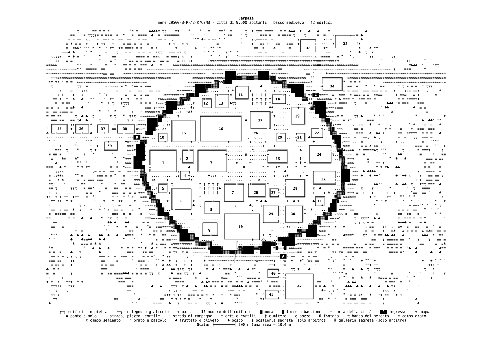</a>

**Grande città, Rinascimento, costa**

<a href="img_examples/thumbs/grande_citta_rinascimento_costa.png">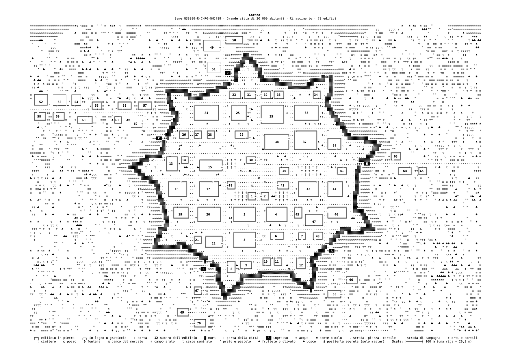</a>

**Paese, basso medioevo, collina**

<a href="img_examples/thumbs/paese_basso_medioevo_collina.png">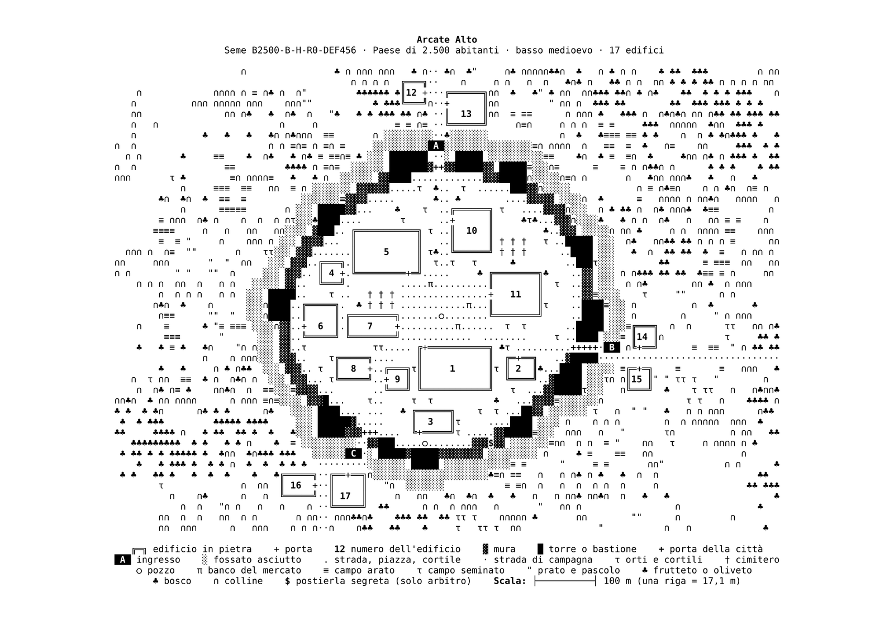</a>

**Villaggio, alto medioevo, foresta**

<a href="img_examples/thumbs/villaggio_alto_medioevo_foresta.png">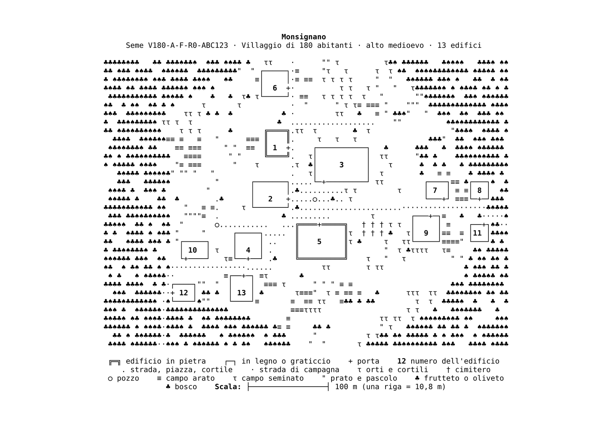</a>

**Castello motte and bailey, palude**

<a href="img_examples/thumbs/castello_motte_palude.png">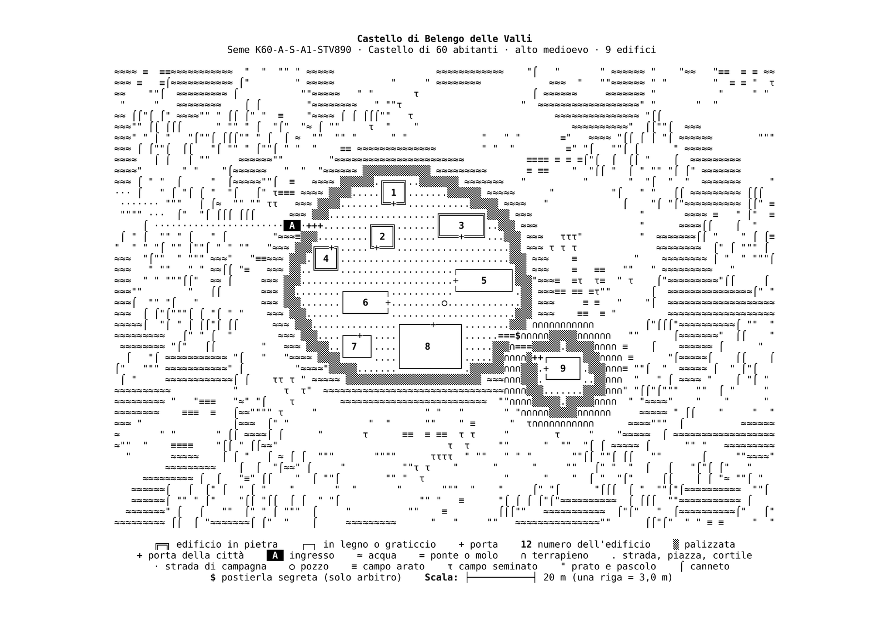</a>

**Castello, basso medioevo, lago**

<a href="img_examples/thumbs/castello_basso_medioevo_lago.png">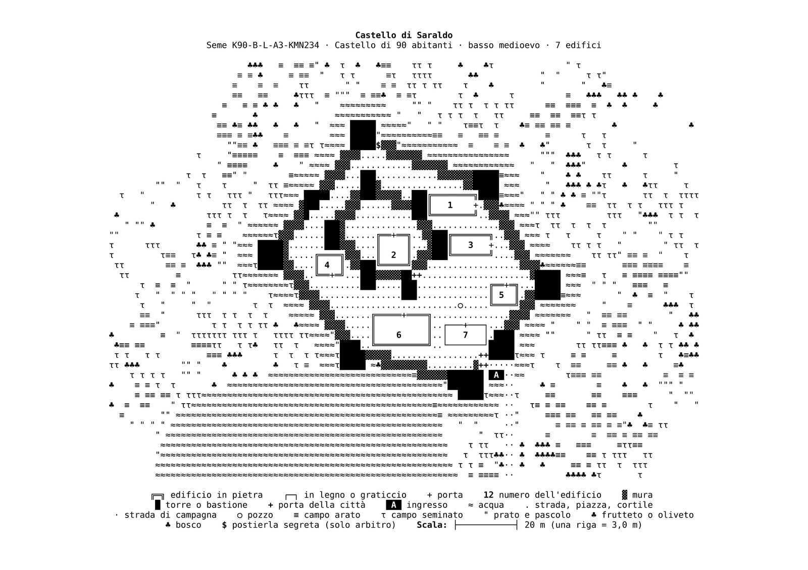</a>

**Fortezza stellata, solo tastiera**

<a href="img_examples/thumbs/fortezza_stellata_solo_ascii.png">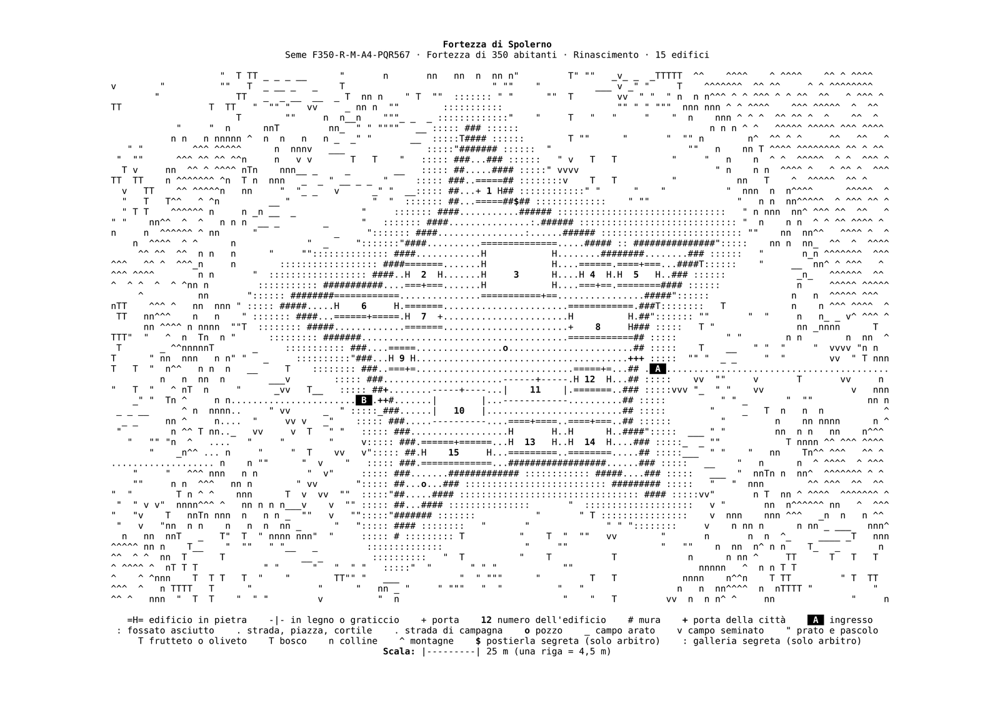</a>

### A colori

I due schemi a colori, `--colori 4` (su bianco) e `--colori 5` (su nero): ogni simbolo nel suo colore, i segreti in magenta, e nomi di luoghi e persone nella lingua scelta.

**Paese, basso medioevo, fiume (avventura), a colori su bianco · nomi italiani**

<a href="img_examples/thumbs/paese_a_colori_su_bianco.png">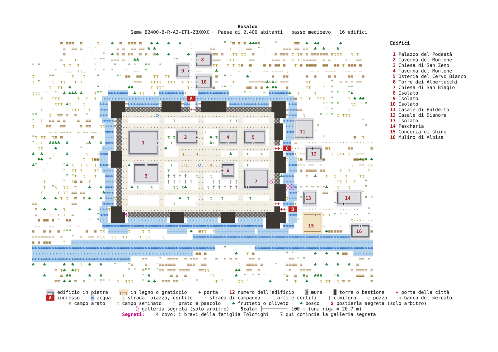</a>

**Lo stesso paese a colori su nero**

<a href="img_examples/thumbs/paese_a_colori_su_nero.png">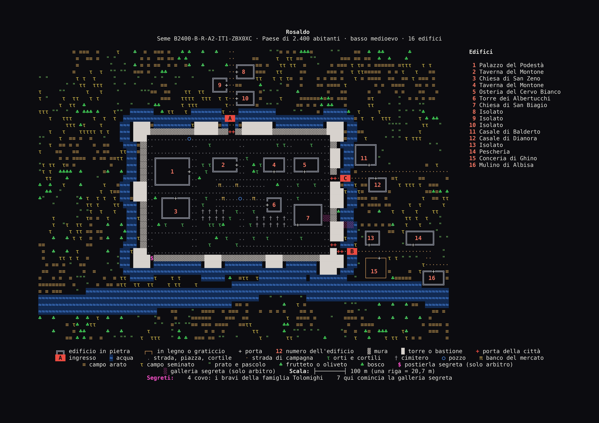</a>

**Villaggio, alto medioevo, collina, a colori su bianco · nomi danesi e svedesi · mappa dei giocatori**

<a href="img_examples/thumbs/villaggio_nordico_a_colori_su_bianco_giocatori.png">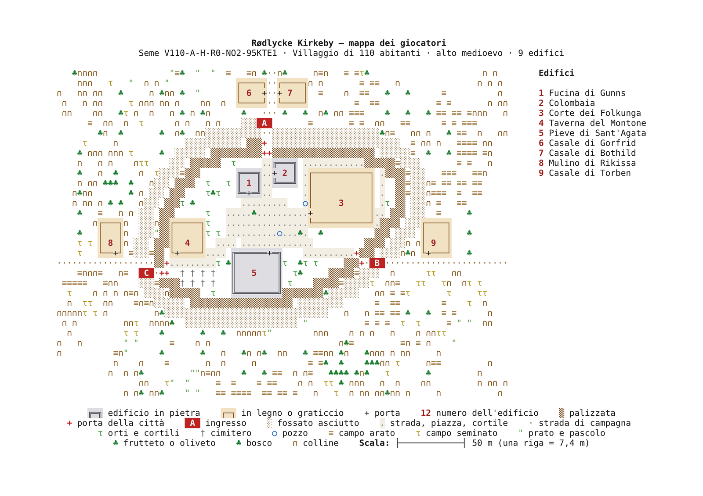</a>

**Città, Rinascimento, costa (avventura), a colori su nero · nomi italiani**

<a href="img_examples/thumbs/citta_costa_a_colori_su_nero.png">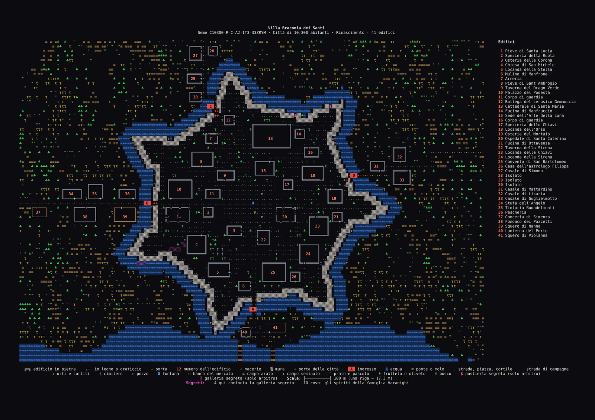</a>

**Castello, Rinascimento, foresta (avventura), a colori su nero · nomi gaelici**

<a href="img_examples/thumbs/castello_gaelico_a_colori_su_nero.png">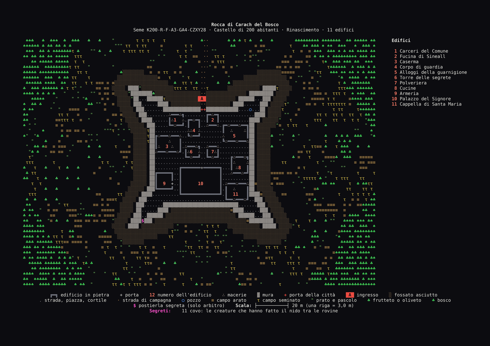</a>

**Fortezza, Rinascimento, pianura (avventura), solo tastiera a colori su bianco · nomi francesi**

<a href="img_examples/thumbs/fortezza_solo_tastiera_a_colori_su_bianco.png">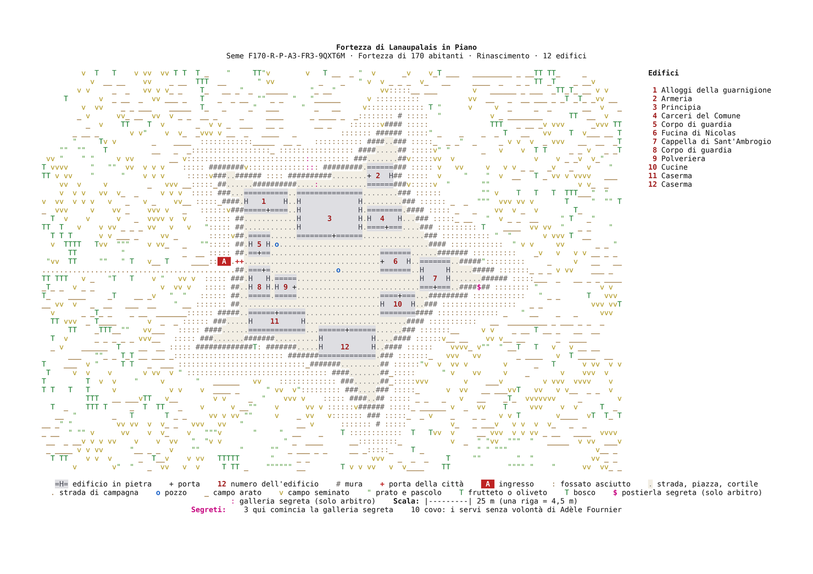</a>

## Fonti e licenze

- **Popolazione, densità, mestieri, clero, nobili, guardie, bestiame**: S. John Ross, *Medieval Demographics Made Easy* (Cumberland Games). Sono usati solo i numeri; il testo non è copiato.
- **Contado, rendite, proprietà, tempi difficili**: Skerples, [*OSR: Land and Investments*](https://coinsandscrolls.blogspot.com/2017/09/osr-land-and-investments.html) (*Coins and Scrolls*). Sono usati solo i numeri.
- **Mostri, indizi e tesori**: da [WyrmDelve](https://github.com/alepersichetti/WyrmDelve); le tabelle dei tesori sono adattate dall'*Old-School Essentials System Reference Document* © 2019 Gavin Norman, Open Game Content con [Open Game License 1.0a](LICENSE-OGL.txt).
- **Disegno del castello** nella schermata di benvenuto: Marcin "StfoReK" Glinski (firma `fsc`), da [asciiart.eu](https://www.asciiart.eu/art/692e286c8f3199ee).
- I **font** mantengono le loro licenze (vedi `fonts/README.md`).

WyrmUrbiGen è software libero con licenza [GNU General Public License v3.0](LICENSE).
