# WyrmUrbiGen

<div align="center">

[Italiano](README.it.md) · **English**

</div>

<table align="center"><tr><td><pre>
                                 ____
                              .-"    `-.      ,
                            .'          '.   /j\
                           /              \,/:/#\                /\
                          ;              ,//' '/#\              //#\
                          |             /' :   '/#\            /  /#\
                          :         ,  /' /'    '/#\__..--""""/    /#\__
                           \       /'\'-._:__    '/#\        ;      /#, """---
                            `-.   / ;#\']" ; """--./#J       ':____...!
                               `-/   /#\  J  [;[;[;Y]         |      ;
""""""---....             __.--"/    '/#\ ;   " "  |     !    |   #! |
             ""--.. _.--""     /      ,/#\'-..____.;_,   |    |   '  |
                   "-.        :_....___,/#} "####" | '_.-",   | #['  |
                      '-._      |[;[;[;[;|         |.;'  /;\  |      |
                      ,   `-.   |        :     _   .;'    /;\ |   #" |
                      !      `._:      _  ;   ##' .;'      /;\|  _,  |
                     .#\"""---..._    ';, |      .;{___     /;\  ]#' |__....--
          .--.      ;'/#\         \    ]! |       "| , """--./_J    /
         /  '%;    /  '/#\         \   !' :        |!# #! #! #|    :`.__
        i__..'%] _:_   ;##J         \      :"#...._!   '  "  "|__  |    `--.._
         | .--""" !|""""  |"""----...J     | '##"" `-._       |  """---.._
     ____: |      #|      |         #|     |          "]      ;   ___...-"T,
    /   :  :      !|      |   _______!_    |           |__..--;"""     ,;MM;
   :____| :    .-.#|      |  /\      /#\   |          /'               ''MM;
    |""": |   /   \|   .----+  ;      /#\  :___..--"";                  ,'MM;
   _Y--:  |  ;     ;.-'      ;  \______/#: /         ;                  ''MM;
  /    |  | ;_______;     ____!  |"##"""MM!         ;                    ,'MM;
 !_____|  |  |"#"#"|____.'""##"  |       :         ;                     ''MM
  | """"--!._|     |##""         !       !         :____.....-------"""""" |'
  |          :     |______                        ___!_ "#""#""#"""#"""#"""|
__|          ;     |MM"MM"""""---..._______...--""MM"MM]                   |
  "\-.      :      |#                                  :                   |
    /#'.    |      /##,                                !                   |
   .',/'\   |       #:#,                                ;       .==.       |
  /"\'#"\',.|       ##;#,                               !     ,'||||',     |
        /;/`:       ######,          ____             _ :     M||||||M     |
       ###          /;"\.__"-._   """                   |===..M!!!!!!M_____|
                           `--..`--.._____             _!_
                                          `--...____,="_.'`-.____        fsc
</pre></td></tr></table>

<div align="center">

<br>
Works with any analogue "OSR" roleplaying game. Sibling of [WyrmHex](https://github.com/alepersichetti/WyrmHex) and [WyrmDelve](https://github.com/alepersichetti/WyrmDelve).

</div>

### WyrmUrbiGen v1.0.0

**WyrmUrbiGen** draws random **villages, towns, cities, big cities, castles, and fortresses** for old school (OSR) campaigns, made only of letters and symbols like the roguelikes NetHack, ADOM and Dwarf Fortress. Every building has its **number** on the referee's map, and the **key** (as `.txt` and as a **PDF file**) tells everything about the settlement: history, government and factions, the NPCs who matter, the people of every building with their OSR stats, demographics, the economy of the country around, rumours and events.

At start the program asks whether the settlement is:

- a **place of rest** for adventurers: inns, healers, smiths, horses, mercenaries and followers for hire, prices in gold pieces, jobs and hooks;
- a **place of adventure**, either **in ruins** or **inhabited and threatened**. In ruins (the usual choice for a city): abandoned for decades or centuries, with breaches in the walls and brambles in the streets, full of monsters (the city of the dead, the goblin warren, a beast's nest, the sleeping dragon, the faithful of the nameless god, the drowned town, the fungus garden, the ghost court, the orc stronghold), with **a layered history** (founding, height, fall, and whoever came after, leaving traces in the buildings), whoever rules the ruins, and rumours, events and hooks for those who go there. Inhabited: a threat (brigands, a cult, plague, a curse, an orc siege, a night beast, a necromancer lord, something rising from the water, a dragon, a collapsed mine, a feud). Either way, with a clock of what happens if nobody steps in, **wandering monsters, monsters and clues in the buildings, and treasure** from WyrmDelve's tables (its bestiary and the *Old-School Essentials* treasure).

**Treasure** stays within the place's means: only the threat has a lair hoard (its *Old-School Essentials* treasure type, rolled several times and brought to about 1,200, 3,500, 10,000 or 22,000 gp on average by danger, a little less in a village and a little more in a city; magic items stay those of a single hoard); the other monsters and a few empty buildings have the unguarded treasure of a dungeon level as dangerous as the place. In all, about 750-2,000 gp at danger 1, 3,000-7,500 at danger 2, 10,000-20,000 at danger 3, 25,000-50,000 at danger 4 (cities towards the top, villages towards the bottom).

Every settlement has **a layered history**: its founding and two to four events (a fire, a feud, a famine, a heresy, a treasure found, a betrayal...), each with its age and **the legacy** it left: a grudge, an exile, a claim, a debt, a lost relic, a secret, a vow, a curse, a hidden treasure, a betrayal, a prophecy, a fortune. A ruin's layers are those of its history (founding, height, fall, sack). On those legacies stand:

- **the factions** (two to five by type; around a ruin, scavengers, brigands, rival adventurers, cultists, scholars...): name and emblem, who they are and how strong, what they want and **why** (the layer it all goes back to), how they work and what they hold, their base, who leads them, rivals and allies;
- **the NPCs who matter** (the ruler, the threat's leader, the faction leaders, a few keepers; around a ruin, the faction leaders and a survivor): three sentences of personal history tied to families, gods, events and nearby towns, what they want and why, a secret, **their ties** to the other NPCs who matter (ally, rival, creditor, secret love, kin, blackmailer, mentor...) with the building number, and a job for the characters.

The **rumours** are a d10 table from a generator: who tells it (fifty sources), how (twenty-four ways of telling), what (over a hundred contents, drawn from the place's people, factions, families, gods, history and threat), and whether it is true, false or **only partly true** (with what is wrong, for the referee): hundreds of thousands of different rumours. The tables are in `data/intrigue.json` and `data/rumors.json`.

#### Types and population

Choose the type, or let the program choose it. Population follows S. John Ross's *Medieval Demographics Made Easy*:

| Type | People |
|---|---|
| Village | 20-1,000, usually 50-300 |
| Town (borough) | 1,000-8,000, usually 2,500 |
| City | 8,000-12,000 |
| Big city | 12,000-100,000 |
| Castle | 20-250 household, servants and garrison |
| Fortress | 80-1,000 garrison and civilians |

After the type you can type the exact number of people (Enter keeps a random one). From that number come the density (people per hectare), the dwellings, the nobles, the clergy, the guards, the livestock and how many shops of every trade there are (the article's *support values*: a shoemaker every 150 people, an inn every 2,000...). The most important shops go on the map; all of them appear in the demographics. In big places every numbered box is a group of houses or a block.

#### Eras: architecture and town planning

| Era | What they look like |
|---|---|
| **Early Middle Ages** | palisades and ditches, villages scattered around the lord's timber hall, *motte-and-bailey* castles (an earth mound with a timber tower and a fenced yard), rectangular Roman *castra* with cardo and decumanus, towns shut inside the old Roman square with crooked streets over the ancient grid |
| **Late Middle Ages** | stone walls with towers, gates flanked by towers, communal squares with the town hall, cathedrals and baptisteries, tower houses, planned new towns on a grid, friaries along the walls, castles with a keep and sometimes a second, inner ward |
| **Renaissance** | modern fortifications with arrow-head bastions, radial or grid ideal cities, star forts with a parade ground, square citadels with corner bastions, palaces, loggias, powder magazines, printing shops |

#### Terrain

Plains, hills, mountains, forest, swamp, coast, river and lake. The terrain changes the map: the sea and the lake cut the walls and bring a pier, the river becomes a moat crossed by a bridge, in the mountains the town stretches along the ridge, the forest leaves a clearing of fields, the swamp surrounds a dry island. All around lie the **fields** in strips and patches (ploughed, sown, meadows, orchards), different for every terrain.

#### The economy of the country around

From the rules of *OSR: Land and Investments* (Skerples, the *Coins and Scrolls* blog): how developed the country is, how many peasants and villages live in the surrounding 6-mile hex (the same as WyrmHex's), the lord's net revenue (halved or divided by 10 in troubled times, that is when there is a threat), and **property for sale** with cost, income and tenants: farms, manors, inns, shops, mines.

---

## 1. What you need

Put these files in the **same folder**:

- `wyrmurbigen.py` (the program)
- the `data` folder (the words and tables: buildings, people, settlements, demographics, economy; monsters, clues and treasure come from WyrmDelve)
- the `fonts` folder (the fonts of the map and of the book)
- `requirements.txt`

You also need **Python 3.8 or newer** (the latest version is best).

## 2. Installing

As for WyrmHex and WyrmDelve, just once:

**Windows**
```
py -m venv .venv
.venv\Scripts\activate
pip install -r requirements.txt
```

**macOS and Linux**
```
python3 -m venv .venv
source .venv/bin/activate
pip install -r requirements.txt
```

The libraries are **Pillow** (the images), **fpdf2** (the PDF book) and **asciimatics** (the menus you scroll with the arrow keys).

## 3. Making a settlement

With the virtual environment active:

```
python wyrmurbigen.py
```

The welcome screen with the castle comes up, then the questions. **Multiple-choice questions are menus**: arrows **↑ ↓**, **Enter** to confirm, or the number of the option. Questions where you type have a ready answer in square brackets: Enter accepts it.

1. **Language**: Italian or English.
2. **What do you want to do?** A random settlement, **I'll choose**, or **rebuild a settlement from its seed**.
3. If you choose, every question also has the answer **At random**:
   - **place of rest or place of adventure**;
   - **type** (village, town, city, big city, castle, fortress) and **number of people**;
   - **era** (Early Middle Ages, Late Middle Ages, Renaissance);
   - **terrain** (plains, hills, mountains, forest, swamp, coast, river, lake), each with a short description. In the **mountains** the settlement is **perched** on a spur: cliffs all round (`Λ`) but on the side of the one way up, where one or two gates open and the roads wind down in hairpin bends; inside, the steepest side lanes are flights of steps (`≣`) and the castle, the palace and the great temple stand at the top; no moats, the cliffs are enough;
   - for a place of adventure, the **danger** from 1 to 4 (for characters of level 1-2, 3-4, 5-7, 8 and up) and its **state**: **in ruins** (monsters and a layered history) or **inhabited and threatened**; at random, a city is always in ruins, other settlements one time in three;
   - the **language the place names sound like**, each with three sample names: medieval Italian, Old English, Renaissance English, Scottish Gaelic, Tolkienesque (elvish), Persian and Arabesque, Byzantine Greek, German, French, Danish and Swedish, Russian and Baltic, or **a mix of them all**;
   - the **tone of the names**: fair, homely, stately, grim or eerie (see [Place names](#place-names));
   - **people's names**: like the places (the same language), **fantasy** (endings mixed from all the languages), or one language of your choice.
4. **Colours**: black on white (for printing), white on light blue, white on black, or **in full colour**, as in WyrmHex, on white or on black: every symbol in its own colour (water blue, woods green, walls stone grey, timber brown, gates red, secrets magenta), and on white pale fills under water, streets and buildings (see [In colour](#in-colour) in the gallery).
5. **Symbols**: WyrmDelve's (`▓ █ ≈ ♣ ╔═╗`) or **keyboard characters only**, as in WyrmHex.
6. **Name on the map**: the generated one, one of yours, or none.
7. **What goes in the key**: story, people, (in a place of adventure) monsters and treasure, and intrigue (the NPCs who matter and the factions); Space ticks and unticks.
8. **Units**: metres or feet.
9. **Print format**: A4, A3, A2 or A1, with the suggested one already highlighted.
10. **Which files**: **PNG** maps and a PDF book apart, **PDF** maps and a PDF book apart, or **one single PDF** with the two maps and then the book.
11. **Again, in another look?** At the end you can make the same settlement again with other colours, symbols, paper and files, as many times as you like: the new maps keep the earlier ones and have the paper and style in their names (`<seed>_referee_A3_c5.png`, `_c4_ascii`).

## 4. The seed

Every settlement has a **seed**, like `C9500-B-R-A2R-DE4-K7Q2MB`: type and people, era, terrain, purpose, danger and state, names and tone, code.

| Part | Values |
|---|---|
| Type | `V` village, `B` town, `C` city, `G` big city, `K` castle, `F` fortress, followed by the number of people |
| Era | `A` Early Middle Ages, `B` Late Middle Ages, `R` Renaissance |
| Terrain | `P` plains, `H` hills, `M` mountains, `F` forest, `S` swamp, `C` coast, `R` river, `L` lake |
| Purpose | `R0` place of rest, `A1`-`A4` place of adventure with its danger, then its state: `R` in ruins, `T` inhabited and threatened |
| Names | `IT` medieval Italian, `OE` Old English, `RE` Renaissance English, `GA` Scottish Gaelic, `TO` Tolkienesque, `PA` Persian and Arabesque, `BY` Byzantine Greek, `DE` German, `FR` French, `NO` Danish and Swedish, `RU` Russian and Baltic, `MX` a mix of them all; then the tone: `1` fair, `2` homely, `3` stately, `4` grim, `5` eerie; then, if the people are not named like the places, `X` (fantasy) or the code of their language (`DE4NO`: German places, Danish and Swedish people) |

**The same seed always gives the same settlement**: map, people, monsters and treasure. The seed is also the name of its folder inside `settlements_generated`. Seeds made by older versions still work and give the same map: without the state (like `C9500-B-R-A2-DE4-K7Q2MB`) the threat can be any, ruins included; without the names part (like `C9500-B-R-A2-K7Q2MB`) the places keep their medieval Italian names of old. Their people, families, nearby towns and gods, though, have made-up names, as in every new seed.

### Place names

WyrmUrbiGen is a fantasy generator: it names no real places, families, saints or religions. It starts from real particles of eleven languages to make up names that *sound* like those languages but do not exist.

The names of the settlement, of the dungeon nearby and of the shops named after a place are built from the **roots** in `data/names.json`: for every language, syllables and name elements for the start, the middle and the end of a word, plus whole words that go before (*Belle-*, *Borgo*, *Dar al-*) and after (*-le-Grand*, *Magna*, *am Berg*). Every tone has roots of its own, mixed with the common ones. Each language and tone can make **11 to 14 million names**; the mix of them all, hundreds of billions.

**People's names** follow the same language: first names, family names and the way they are put together (*Inga Bjørnsdotter*, *Cailean mac Artair*, *Bahram ibn Ismail*, *Berthold von Salzburg*, *Anna Olegovna*), and so do the families in the names of buildings and factions; the towns people come from are towns of the same land. Every name is a beginning and an ending of the language (*Wern* + *hart*, *Wulf* + *stan*, *Lebed* + *ensky*): real particles, made-up names, about **1,050 male and 1,050 female first names and 1,050 family names per language**. Every settlement has a dozen families and a dozen towns nearby, which come back in its buildings, factions, history and rumours. With `--people` / `--persone` you can name the people in **another language** than the places, or make them **fantasy**: a beginning of the language with an ending of any language (*Siegisa Zimmavi*, *Dietost Ludrawsohn*), about 11,500 names of each kind. The roots are in `data/names.json` too.

**The gods** are made up as well: every settlement worships five, each the god or goddess of something (the harvest, storms, the dead, the sea on the coast, the hunt in the forest...), with names built from roots of their own (*Orsaldra*, *Velmor*, *Ilyra*). Temples, shrines, cloisters, monasteries, gates and quarters bear their names; churches become temples, bishops high priests, and on the map graves are `Ω` instead of a cross.

| Tone | | German | Old English |
|---|---|---|---|
| fair | gentle, blooming, welcoming | Lerchenruh, Apfelsee am Lindenquell | Rosemead, Leofhaven |
| homely | country and market, everyday | Hopfenhufen, Salzkotten | Millworth, Elmmill Common |
| stately | noble, royal, grand | Königsfurt, Fürstenstift | Kingcastle Regis, Abbotsgate |
| grim | harsh, dark, of war and death | Finstergraben, Teufelsgrab | Slaughtergrave, Crowgrave Holt |
| eerie | mysterious, haunted, fey | Mondspuk, Eichennebel | Elffell, Thurscott |

## 5. The files you get

Everything goes into `settlements_generated/<seed>/`:

| File | What it holds |
|---|---|
| `<seed>_referee.png` (or `.pdf`) | the **referee's map**: building numbers, the list of the **buildings** (number and name), secret posterns `$`, secret tunnel `░`, and a **Secrets** line (the thieves' hideout, the threat's lair, where the tunnel starts) |
| `<seed>_players.png` (or `.pdf`) | the **players' map**: the same map, numbers and list of buildings, without the secrets |
| `.txt` next to every map | the map as text, keyboard characters only |
| `<seed>_key.txt` | the **key**: history, threat, government, the NPCs who matter and the factions, demographics, economy, services and mercenaries, rumours and events, walls and gates, and every building with its inhabitant |
| `<seed>_key.pdf` | the same key as an **A4 book** (headings in Sebaldus-Gotisch, text in Crimson Text); with the **single PDF** option it also holds the two maps |

### Symbols

| Symbol | Keyboard | Meaning |
|---|---|---|
| `╔═╗ ║` | `=H=` | stone building |
| `┌─┐ │` | `-|-` | timber or half-timbered building |
| `+` | `+` | door (in bold: town gate) |
| `12` | `12` | building number (referee only) |
| `▓` | `#` | walls |
| `█` | `@` | tower or bastion |
| `▒` | `%` | palisade |
| `[A]` | `[A]` | entrance from the road |
| `░` | `:` | dry ditch (on the referee's map it can be the secret tunnel) |
| `≈` | `~` | water: river, lake, sea, moat |
| `=` | `=` | bridge or pier |
| `.` `·` | `.` | street, square, yard; country road |
| `τ` | `v` | kitchen gardens; sown field |
| `≡` | `_` | ploughed field |
| `"` | `"` | meadow and pasture |
| `♣` `♠` | `T` `Y` | woods, orchard |
| `∩` `▲` | `n` `^` | hills, mountains |
| `†` | `t` | graveyard |
| `○` `Θ` `π` | `o` `O` `h` | well, fountain, market stall |
| `∴` | `*` | rubble |
| `$` | `$` | secret postern (referee only) |

**The list of buildings** goes beside the map or under it, whichever prints the map with bigger letters on the paper you chose (or on the suggested one): usually beside it, under it for long, low maps.

**Scale.** At the bottom of the legend there is a scale bar. Letters are twice as tall as they are wide: a row of letters is worth twice a column, and the key says how many metres (or feet) a row is worth.

## 6. In a hurry: the options

```
python wyrmurbigen.py --type city --era late --terrain river --purpose adventure --danger 2 --state ruin
python wyrmurbigen.py --population 30000 --era renaissance --terrain coast --single-pdf
python wyrmurbigen.py --names gaelic --tone eerie --type castle
python wyrmurbigen.py --seed C9500-B-R-A2R-DE4-K7Q2MB --format A3 --ascii-only
python wyrmurbigen.py --lingua it --tipo castello --scopo riposo --png
```

| Option | What it does |
|---|---|
| `--language` / `--lingua` | `en` or `it` |
| `--type` / `--tipo` | `village`, `town`, `city`, `bigcity`, `castle`, `fortress` (or 1 to 6) |
| `--population` / `--popolazione` | number of people (if the type is missing, it is chosen from the number) |
| `--era` / `--epoca` | `early`, `late`, `renaissance` (or 1 to 3) |
| `--terrain` / `--terreno` | `plains`, `hills`, `mountains`, `forest`, `swamp`, `coast`, `river`, `lake` |
| `--purpose` / `--scopo` | `rest` or `adventure` |
| `--danger` / `--pericolo` | 1 to 4 (place of adventure only) |
| `--state` / `--stato` | `ruin` (in ruins, monsters and a layered history) or `inhabited` (inhabited and threatened); place of adventure only |
| `--names` / `--nomi` | `italian`, `old english`, `renaissance`, `gaelic`, `tolkien`, `persian`, `byzantine`, `german`, `french`, `danish`, `russian`, `mixed` (or 1 to 12) |
| `--tone` / `--tono` | `fair`, `homely`, `stately`, `grim`, `eerie` (or 1 to 5) |
| `--people` / `--persone` | `places` (like the place names), `fantasy` (mixed endings), or a language: `italian`, `old english`, `renaissance`, `gaelic`, `tolkien`, `persian`, `byzantine`, `german`, `french`, `danish`, `russian`, `mixed` |
| `--seed` / `--seme` | rebuilds the settlement of that seed |
| `--colors` / `--colori` | 1 black on white, 2 white on light blue, 3 white on black, 4 colour on white, 5 colour on black |
| `--format` / `--formato` | `A4`, `A3`, `A2`, `A1` |
| `--png`, `--pdf`, `--single-pdf` / `--pdf-unico` | PNG maps and book, PDF maps and book, or one single PDF |
| `--title` / `--titolo`, `--no-title` / `--senza-titolo` | name on the map |
| `--content` / `--contenuto` | `story`, `people`, `monsters`, `treasure`, `intrigue` separated by commas; `map`; `all` |
| `--units` / `--unita` | `metric` or `imperial` |
| `--ascii-only` / `--solo-ascii` | keyboard characters only |
| `--font` | a monospaced font of your choice |
| `--output` / `--uscita` | folder to save into |

Whatever you leave out is chosen at random. `python wyrmurbigen.py --help` shows the full list.

## 7. Changing the words

The tables live in the `data` folder, in JSON files you can edit with any text editor (make a copy first):

| File | What it holds |
|---|---|
| `names.json` | the roots of the names of places, people and gods: languages, tones and how a name is put together |
| `settlements.json` | settlement types, eras, terrains, the gods' domains, inn signs, gates, quarters, founding sentences, threats, events, hooks, and for ruins their layered history, events and hooks |
| `buildings.json` | the buildings: name, the types and eras they appear in, how many (`sv`: one every so many people; or `count`), size, stone or timber, where they stand (square, main street, gate, walls, river, outside), who lives there, services and prices, descriptions |
| `people.json` | bynames, trades, traits, wants, secrets, rulers, guilds, classes, spells, mercenaries |
| `intrigue.json` | the layers of history (ages, events, legacies), relics, factions (kinds, emblems, means, rivalries, alliances) and the NPCs who matter (origins, rises, ties, hooks) |
| `rumors.json` | the rumour generator: sources, ways of telling, contents and half-truths |
| `demographics.json` | the numbers of *Medieval Demographics Made Easy* |
| `economy.json` | the numbers of *OSR: Land and Investments* |
| `monsters.json`, `clues.json`, `treasure.json` | from WyrmDelve: bestiary, clues, *Old-School Essentials* treasure |

## Gallery

Referee's maps, scaled down (the originals are 600 dpi). A sample key and book: [sample_key_city.txt](img_examples/sample_key_city.txt), [sample_book_city.pdf](img_examples/sample_book_city.pdf).

**City, Late Middle Ages, river (adventure)**

<a href="img_examples/thumbs/en/city_late_middle_ages_river.png">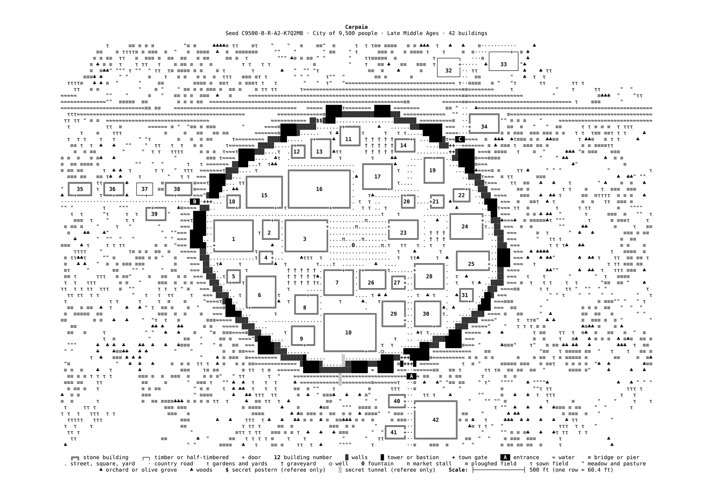</a>

**Big city, Renaissance, coast**

<a href="img_examples/thumbs/en/big_city_renaissance_coast.png">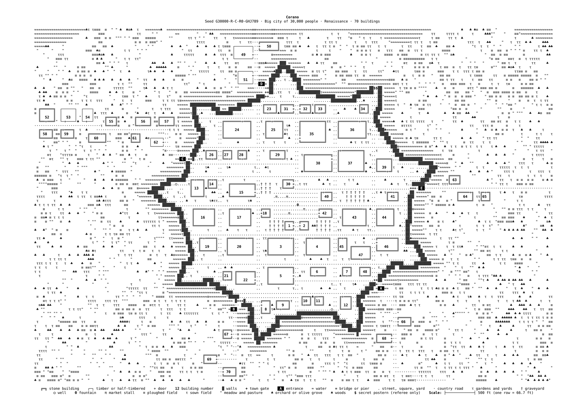</a>

**Town, Late Middle Ages, hills**

<a href="img_examples/thumbs/en/town_late_middle_ages_hills.png">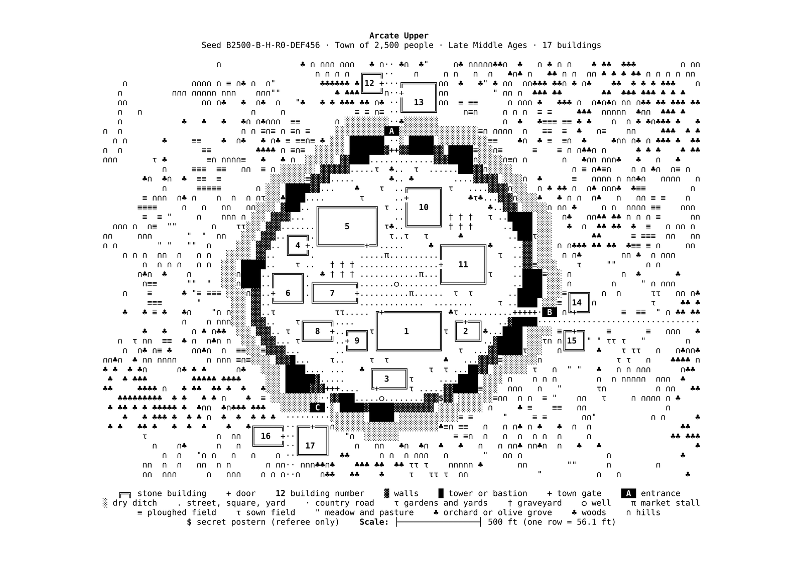</a>

**Village, Early Middle Ages, forest**

<a href="img_examples/thumbs/en/village_early_middle_ages_forest.png">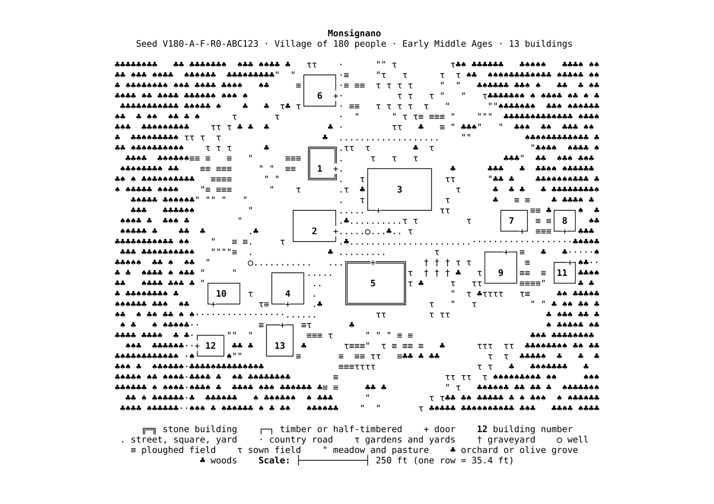</a>

**Motte-and-bailey castle, swamp**

<a href="img_examples/thumbs/en/motte_and_bailey_castle_swamp.png">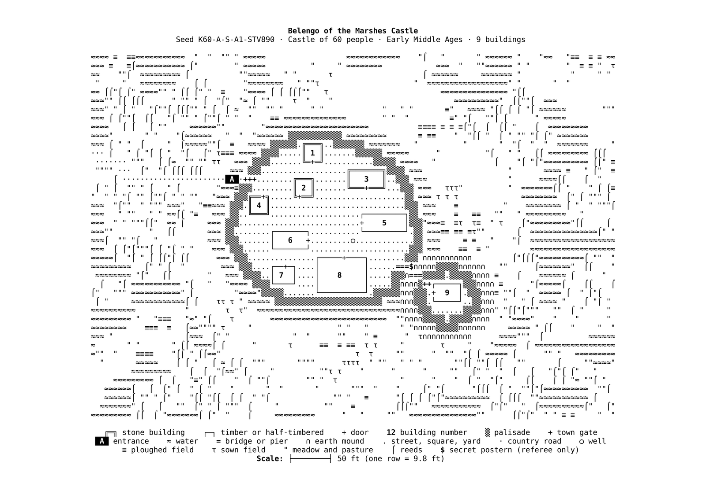</a>

**Castle, Late Middle Ages, lake**

<a href="img_examples/thumbs/en/castle_late_middle_ages_lake.png">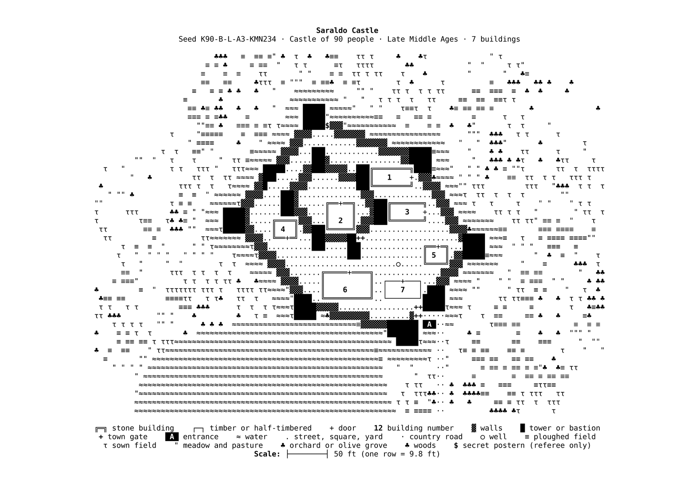</a>

**Star fort, keyboard characters only**

<a href="img_examples/thumbs/en/star_fort_keyboard_only.png">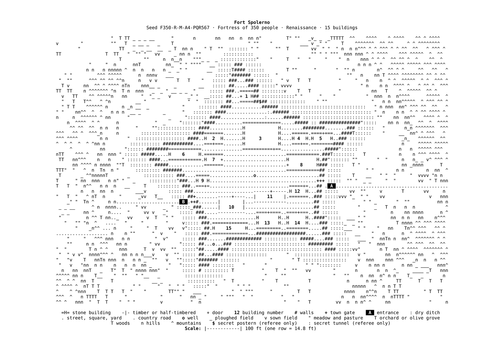</a>

### In colour

The two colour schemes, `--colors 4` (on white) and `--colors 5` (on black): every symbol in its own colour, the secrets in magenta, and place and people's names in the chosen language.

**Town, Renaissance, coast (adventure), colour on white · Renaissance English names**

<a href="img_examples/thumbs/en/town_colour_on_white.png">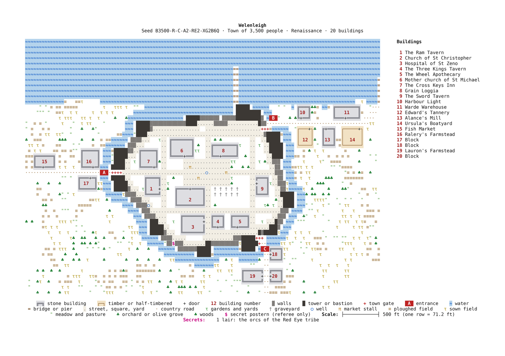</a>

**The same town in colour on black**

<a href="img_examples/thumbs/en/town_colour_on_black.png">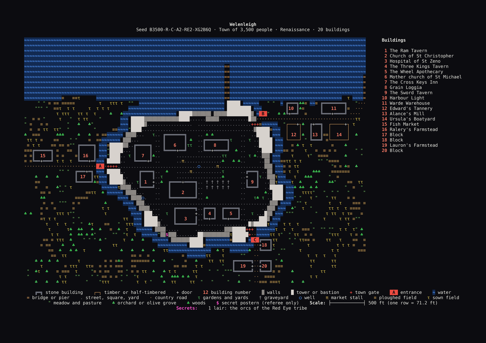</a>

**Village, Early Middle Ages, hills, colour on white · Danish and Swedish names · players' map**

<a href="img_examples/thumbs/en/norse_village_colour_on_white_players.png">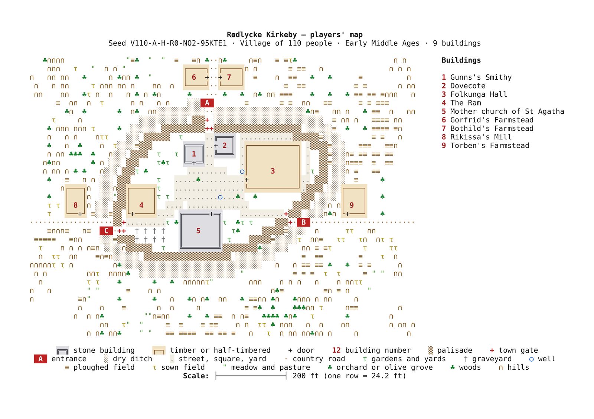</a>

**City, Renaissance, coast (adventure), colour on black · Italian names**

<a href="img_examples/thumbs/en/coastal_city_colour_on_black.png">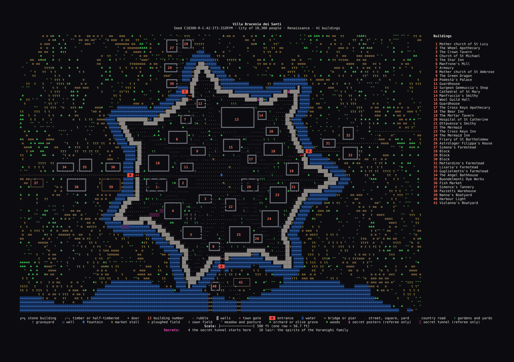</a>

**Castle, Renaissance, forest (adventure), colour on black · Gaelic names**

<a href="img_examples/thumbs/en/gaelic_castle_colour_on_black.png">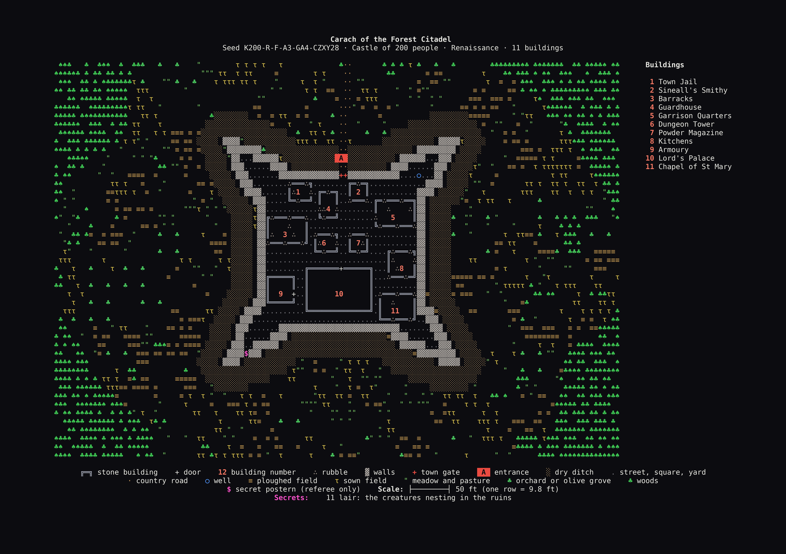</a>

**Fortress, Renaissance, plains (adventure), keyboard characters only in colour on white · French names**

<a href="img_examples/thumbs/en/fortress_keyboard_only_colour_on_white.png">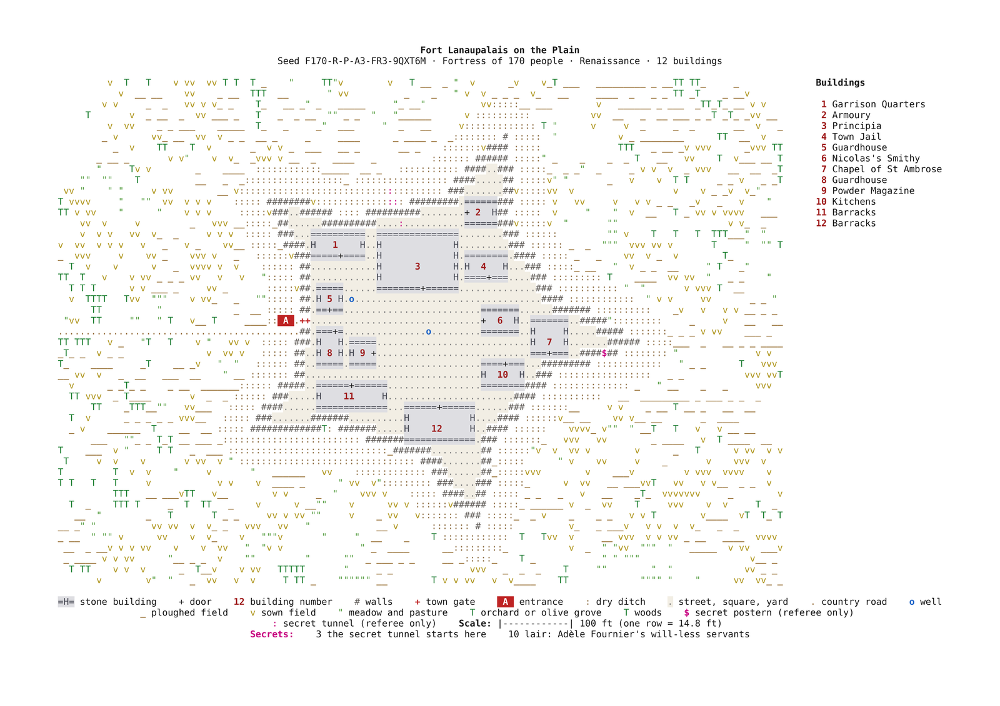</a>

## Sources and licences

- **Population, density, trades, clergy, nobles, guards, livestock**: S. John Ross, *Medieval Demographics Made Easy* (Cumberland Games). Only the numbers are used; the text is not copied.
- **Country, revenue, property, troubled times**: Skerples, [*OSR: Land and Investments*](https://coinsandscrolls.blogspot.com/2017/09/osr-land-and-investments.html) (*Coins and Scrolls*). Only the numbers are used.
- **Monsters, clues and treasure**: from [WyrmDelve](https://github.com/alepersichetti/WyrmDelve); the treasure tables are adapted from the *Old-School Essentials System Reference Document* © 2019 Gavin Norman, Open Game Content under the [Open Game License 1.0a](LICENSE-OGL.txt).
- **Castle drawing** on the welcome screen: Marcin "StfoReK" Glinski (signed `fsc`), from [asciiart.eu](https://www.asciiart.eu/art/692e286c8f3199ee).
- The **fonts** keep their own licences (see `fonts/README.md`).

WyrmUrbiGen is free software under the [GNU General Public License v3.0](LICENSE).
